<div align="center">

# TaxPain

**Tu gestoría en tu Mac.** Conecta tu certificado y TaxPain baja de la AEAT los modelos que
ha presentado tu gestoría, lo cruza con tus facturas, extractos y escrituras, y te dice **qué no
cuadra y qué hacer**. Además lleva tus facturas, tu contabilidad, tus bancos y tus modelos, para
autónomos y sociedades, **sin que tu certificado ni tus datos salgan de tu ordenador**.

[](LICENSE)


[Guía de uso](docs/GUIA.md) · [Arquitectura](docs/ARCHITECTURE.md) · [Decisiones](docs/DECISIONS.md) · [Privacidad](docs/PRIVACIDAD_APP.md)

</div>

> [!WARNING]
> **TaxPain está en beta y no es asesoramiento fiscal.** Calcula, prepara y
> explica, pero la responsabilidad de lo que se presenta ante la AEAT es de quien lo presenta.
> Revisa siempre los borradores y, ante la duda, consulta con un asesor colegiado. En las
> compilaciones de desarrollo nada va a producción: los envíos van al entorno de pruebas de la
> AEAT.
>
> **La versión que se descarga no emite facturas.** La facturación (con VERI\*FACTU, en pruebas)
> está en el código, para quien compila TaxPain con sus datos de productor: ver
> [Instalación](#instalación). VERI\*FACTU de momento sólo envía al entorno de pruebas de la
> AEAT: no lo uses como único programa de facturación cuando el Reglamento (RD 1007/2023) ya te
> obligue.

## Lo más importante

### 1. ¿Se ha equivocado tu gestoría? TaxPain te lo dice

Pagas a una gestoría y confías en que lo hace bien. Pero ¿lo compruebas alguna vez?

- **Baja lo presentado con tu certificado.** En Modelos → «Comprobar lo presentado en la AEAT»,
  con tu certificado y Touch ID, TaxPain consulta en la AEAT tus declaraciones (también las que
  presentó la gestoría) de uno o varios años de golpe: 303, 390, 111, 190, 115, 180, 123, 193,
  130, 131, 349, 347, 200, 202, 232, 216, 296, 369 y 720, y el 100 si eres persona física. Baja
  los justificantes en PDF y saca las casillas exactas. Sólo lee.
- **Lo cruza con los datos reales de tu empresa.** En Importar → «Revisión» → «Revisar la carpeta»
  (y en Evolución → «Qué revisar», los cruces entre modelos): facturas en PDF, libros registro,
  diario, extractos del banco, escrituras y actas, documentos de la Sede… El 303 frente a los
  libros, el 111 frente a las retenciones, el 347 y el 349 por NIF, los pagos del banco frente a
  los modelos, los administradores frente a las escrituras, el Impuesto sobre Sociedades (exención
  de dividendos, bases negativas, reservas), facturas repetidas, saltos de numeración, modelos que
  faltan o que se presentaron tarde…
- **Te dice qué está mal y qué hacer.** Cada hallazgo lleva su gravedad, **de quién es el
  error** (empresa, gestoría o documentación), **lo que podrías recuperar** (estimado) y **hasta
  cuándo puedes rectificar** (4 años, arts. 66-67 LGT). Prepara la lista de qué pedir a la
  gestoría, al Registro o en la Sede, y puedes preguntar a la IA por cada hallazgo. Informe en
  PDF, Excel o Markdown.

Es orientativo: no rectifica ni presenta complementarias por ti, y no sustituye a un asesor.

<p align="center">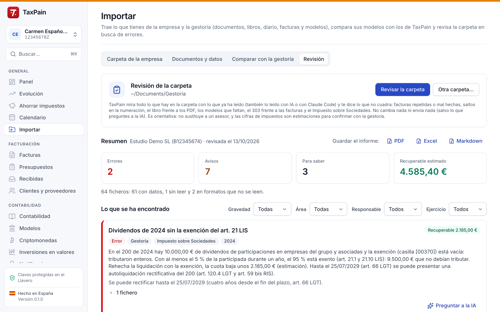</p>

### 2. Pregúntale a Claude por tu empresa (MCP)

Conecta TaxPain con **Claude Desktop** o **Claude Code** con su servidor MCP y pregunta en
lenguaje normal: «¿qué me vence este mes?», «¿quién me debe dinero?», «¿cuánto IVA me sale en el
303?». Claude consulta tus plazos, facturas, cobros, banco, mayor, modelos y criptomonedas, y, si
quieres, deja **borradores** de presupuestos y gastos para que los revises.

Viene **apagado** y se activa empresa por empresa. Nunca emite, presenta, firma ni toca tu
certificado, y cada consulta queda en la auditoría. Ojo: lo que ve Claude no va anonimizado.
Por ahora hay que compilar `taxpain-mcp` y añadirlo a mano a Claude: lo explica
[`docs/CLAUDE_CODE.md`](docs/CLAUDE_CODE.md).

<p align="center">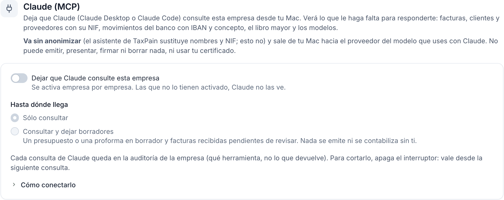</p>

### 3. Cómo va tu negocio, al día

- **Panel**: ingresos, gastos, resultado, tesorería, lo pendiente de cobro y de pago, y la
  **previsión de tesorería** a 13 semanas o 12 meses, con el «dinero que no es tuyo» (IVA y
  retenciones por ingresar). Sale al momento de tu contabilidad en TaxPain y, con BBVA o Revolut
  conectados, los movimientos llegan solos.
- **Evolución**: tus cifras clave año a año con lo que tiene Hacienda (modelo y casilla de cada
  cifra), la variación con el año anterior y un avance del año en curso con los 303 presentados.
- Con varias empresas, **todas a la vez** y las cuentas del grupo consolidadas.

<p align="center">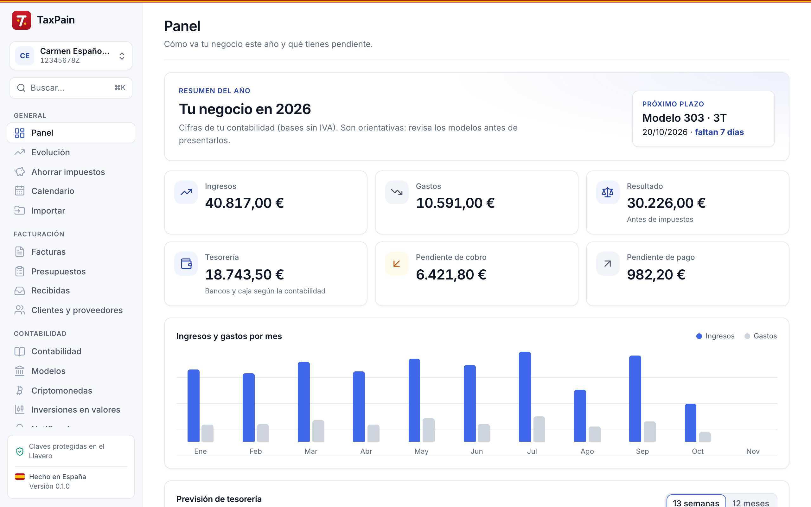</p>

### 4. Criptomonedas e inversiones

- **Criptomonedas**: importa tus operaciones de Kraken, CoinTracking o una hoja de cálculo.
  Ganancias y pérdidas por FIFO o precio medio, asientos, deterioro, casillas de la Renta y aviso
  del 721. Si la gestoría ya calculó los años anteriores, empiezas desde sus saldos.
- **Valores**: conecta **Interactive Brokers** en sólo lectura o sube el informe de **XTB**.
  Acciones, ETF, fondos y opciones, plusvalías latentes, dividendos y retenciones en origen por
  país (con lo que puedes reclamar), paso a euros con el tipo del BCE y aviso del 720.

<p align="center">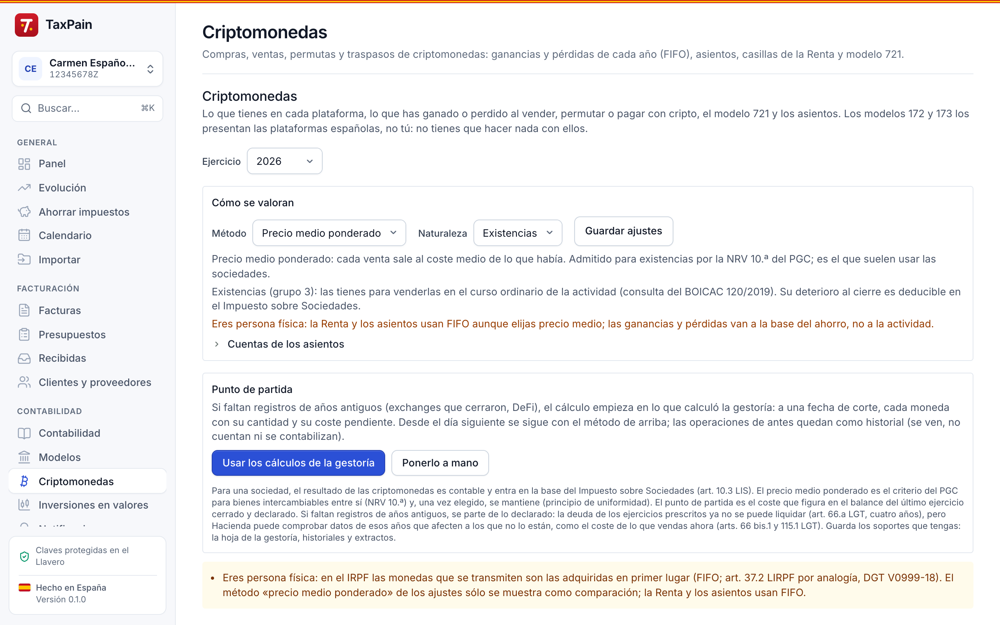</p>

### 5. Tus modelos, hechos y listos para Hacienda

TaxPain calcula tus modelos **casilla a casilla desde tu contabilidad** (303, 130, 111, 115, 123,
216, 349, 390, 202 y 200, y las informativas 347, 190, 180, 193, 184 y 296; también por meses si
tu IVA es mensual), te da el **fichero oficial**
para la Sede y los **prevalida con la AEAT**. La **presentación directa** con tu certificado y
Touch ID ya funciona en el entorno de pruebas de la AEAT y llegará a producción con la versión
firmada. Hasta entonces, revisas y presentas tú.

<p align="center">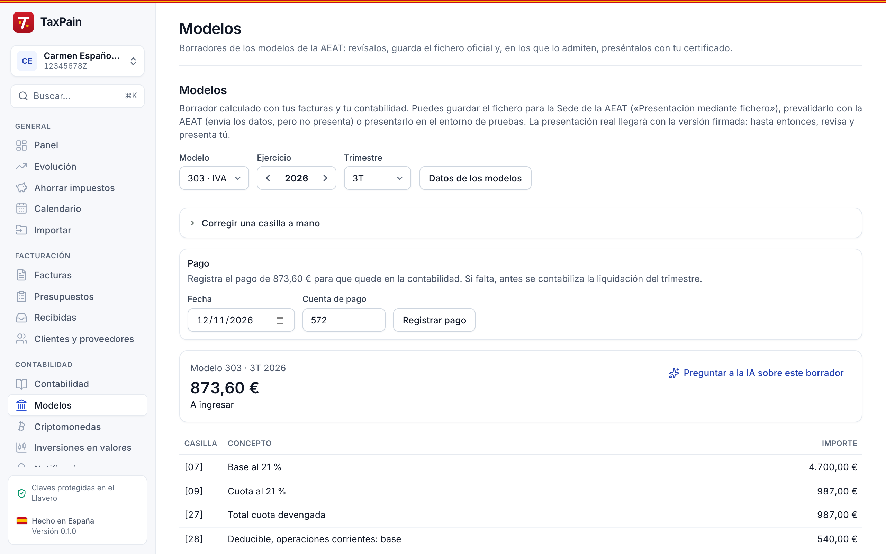</p>

Y más: [ahorrar impuestos](#qué-hace) con el ahorro calculado con tus cifras, calendario fiscal
con festivos locales, facturas Facturae y UBL, bancos, contabilidad completa, notificaciones de
la AEAT y asistente de IA con tus datos anonimizados. Todo en [Qué hace](#qué-hace).

## Vídeos

Grabados con la app real en modo demo (datos inventados). Pulsa una imagen para ver el vídeo.

| | | |
|:-:|:-:|:-:|
| [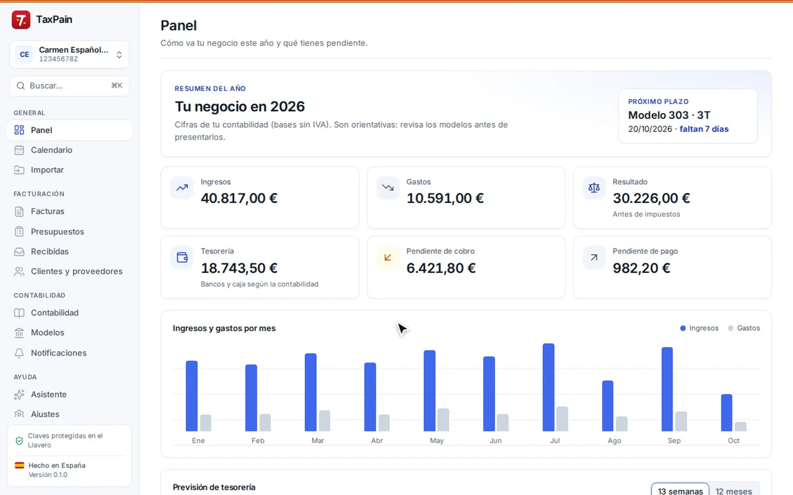](media/clips/recorrido.mp4)<br>**Recorrido por la app** | [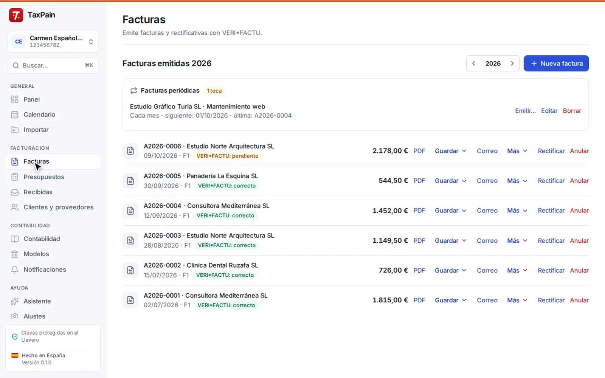](media/clips/factura.mp4)<br>**Emitir una factura** | [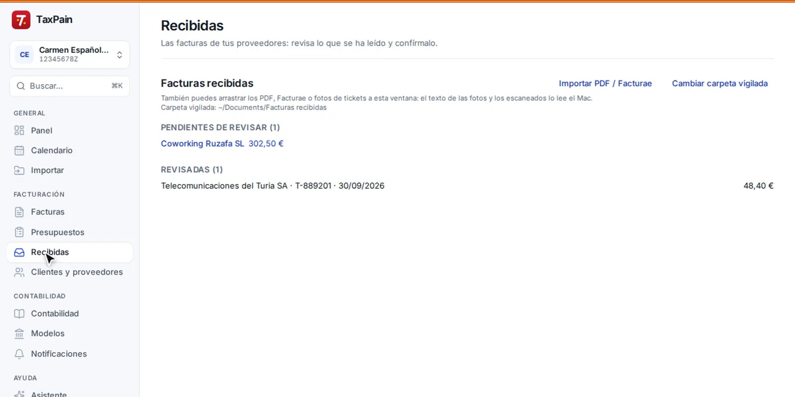](media/clips/recibida.mp4)<br>**Revisar una recibida** |
| [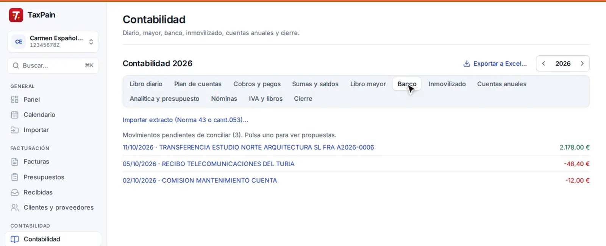](media/clips/banco.mp4)<br>**Conciliar el banco** | [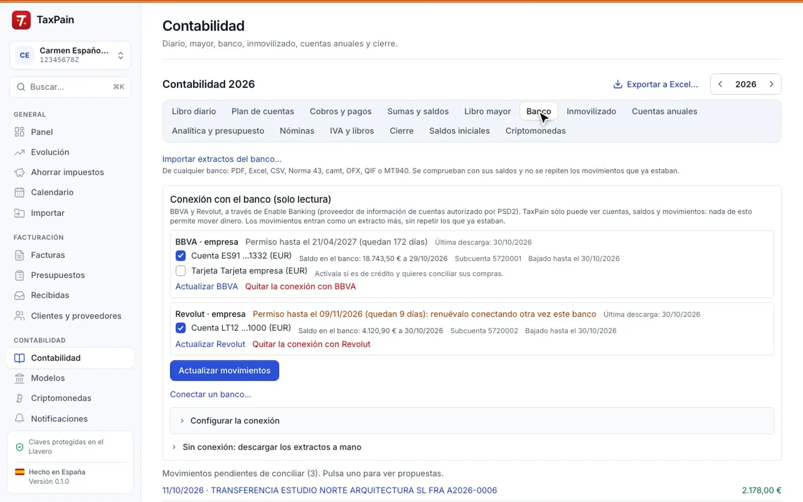](media/clips/bancos.mp4)<br>**BBVA y Revolut conectados** | [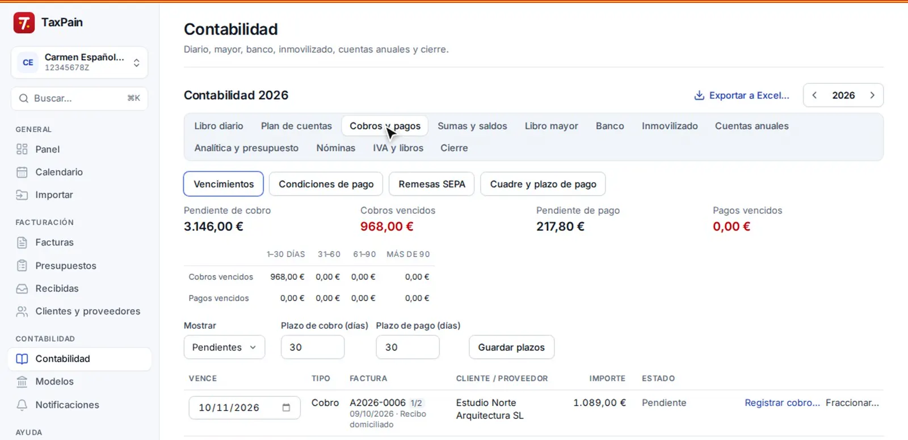](media/clips/cartera.mp4)<br>**Cobros y pagos** |
| [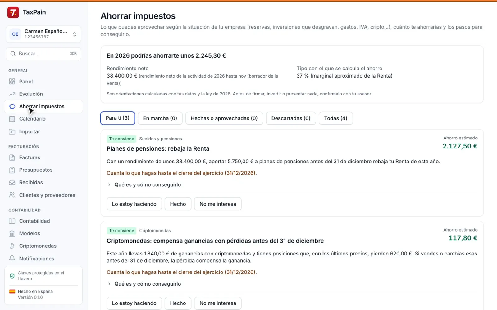](media/clips/ahorro.mp4)<br>**Ahorrar impuestos** | [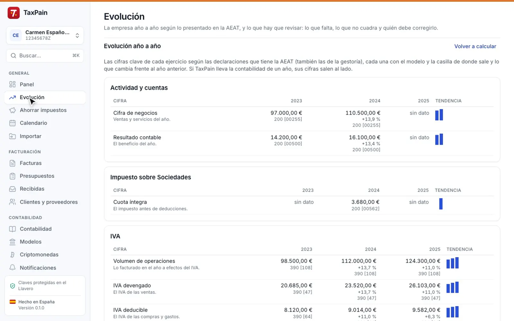](media/clips/evolucion.mp4)<br>**Evolución** | [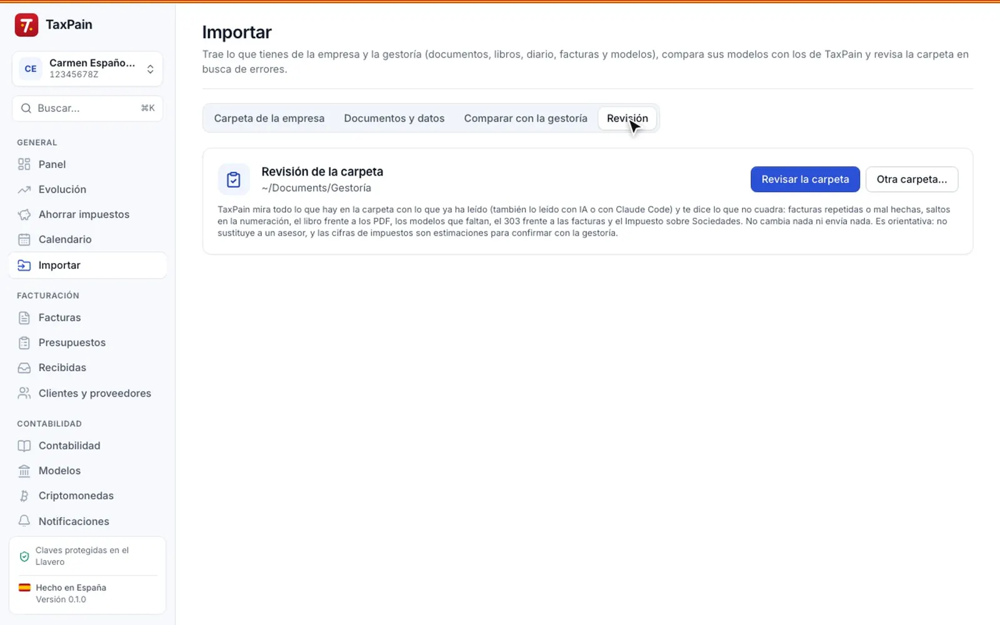](media/clips/revision.mp4)<br>**Revisión de la empresa** |
| [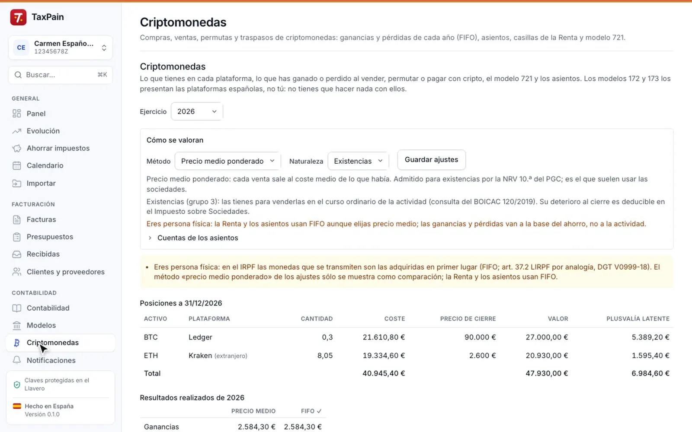](media/clips/cripto.mp4)<br>**Criptomonedas** | [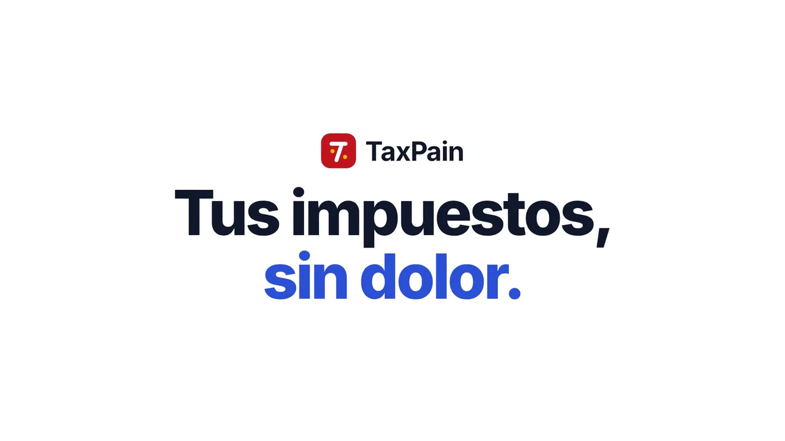](media/clips/presentacion.mp4)<br>**Presentación (35 s)** | |

Más capturas en [`media/screens`](media/screens).

## ¿Por qué?

Ser autónomo o tener una SL en España supone **una docena de modelos al año**, plazos que se
mueven con los festivos, facturas, libros registro y una contabilidad que casi nadie entiende.
Lo habitual es pagar una gestoría y fiarte, o subir tu certificado digital a la web de un
tercero.

TaxPain hace ese trabajo **en tu Mac**: tus datos, tus facturas y tu certificado se quedan en tu
ordenador, cifrados, y cada acto con efectos legales (emitir una factura, firmar, presentar)
**necesita tu confirmación y Touch ID**. No hay servidor de TaxPain: nadie más tiene tus datos.

## Qué hace

| | |
|---|---|
| 📊 **Panel y evolución** | Cifras del año, tesorería y su previsión, impuestos del trimestre y lo pendiente de un vistazo. **Evolución**: cómo van ingresos, gastos, beneficio e impuestos año a año, y qué conviene revisar (con lo que se pagó de más y aún se puede rectificar). |
| 💡 **Ahorrar impuestos** | Recomendaciones según la situación de tu empresa (reservas de capitalización y nivelación, financiación de cine y series, planes de pensiones, amortización acelerada, empresas emergentes, compensar pérdidas de criptomonedas…), con el ahorro calculado con tus cifras, la fecha límite, los requisitos, **los pasos para conseguirlo** y la norma en el BOE. |
| 📅 **Calendario fiscal** | Qué modelos te tocan según tu perfil (303, 130/131, 111, 115, 123, 349, 390, 190, 180, 193, 347, 184, 100, 200, 202, 721, depósito de cuentas…) y cada plazo trasladado por fines de semana y festivos **nacionales, autonómicos y locales**. Avisos y exportación a Calendario (`.ics`). |
| 📥 **Importar la carpeta de la empresa** | Lee la carpeta de documentos (facturas, libros, extractos, escrituras, modelos presentados…) y propone qué importar; **revisión de la empresa** con errores, documentación que falta, modelos sin presentar, el 303 frente a las facturas, lo que se puede recuperar, las **devoluciones ya pedidas y pendientes de cobro** y qué pedir a la gestoría. Descarga de documentos de la AEAT por código CSV. **Carpetas vigiladas**: TaxPain mira una o varias carpetas (con subcarpetas) y lleva las facturas nuevas a Recibidas. |
| 🧾 **Facturación** *(si la compilas tú)* | Facturas completas, simplificadas y rectificativas con IVA, recargo de equivalencia y retención; moneda extranjera con el tipo del BCE; PDF en español o inglés; **Facturae 3.2.2** y **UBL (EN 16931)**; facturas periódicas; correo con la factura adjunta (en Mail); copia en iCloud Drive, Google Drive o Dropbox. Presupuestos y proformas que se convierten en factura. |
| 🧪 **VERI\*FACTU (en pruebas, si la compilas tú)** | **En pruebas; pronto estará listo.** Genera los registros de alta y anulación encadenados con huella SHA-256 y los valida contra el esquema oficial; cola de envío que respeta el tiempo de espera de la AEAT y reintenta si se corta la red; estado de cada factura y **declaración responsable** del productor. De momento **sólo envía al entorno de pruebas de la AEAT** y viene desactivado por defecto. |
| 🇪🇺 **Ventas a particulares de la UE (OSS)** | Umbral de 10.000 € con aviso, facturas con el IVA del país del cliente (tipo confirmado por ti), libro OSS y **borrador del 369** por país. |
| 📨 **Facturas recibidas** | Arrastra PDF, fotos o Facturae (o vigila una carpeta): lee proveedor, NIF, número, fecha e importes (también con el asistente, anonimizado), marca lo dudoso y **nada cuenta hasta que lo revisas**. Inversión del sujeto pasivo para proveedores de la UE y de fuera. |
| 🏦 **Bancos** | Extractos de **cualquier banco y formato** (Norma 43, camt, OFX, QIF, MT940, Excel, CSV, PDF…) comprobados con sus saldos y sin duplicados; opción avanzada: **conexión en solo lectura con BBVA y Revolut** (PSD2, a través de Enable Banking, con tu propia aplicación, en su modo de pruebas); conciliación con propuestas y reglas; remesas SEPA. |
| 📒 **Contabilidad** | Partida doble (PGC y PGC PYMES) con asientos automáticos, libro diario y mayor, sumas y saldos, cobros y pagos, inmovilizado y amortizaciones, leasing, existencias, nóminas, analítica, apertura, cierre, **cuentas anuales** con el modelo oficial, legalización de libros y depósito de cuentas; exportación a a3. |
| 🧮 **Modelos** | 303, 130, 111, 115, 123, 216, 349, 390, 190, 180, 193, 184, 296, 347, 202 y 200 calculados desde tu contabilidad, casilla a casilla, con el **fichero oficial (DR)**, también **por meses** (IVA mensual, REDEME, SII); borradores de los modelos 720, 721 y 232 en hoja de cálculo; rectificativas y complementarias; prevalidación con la AEAT y presentación directa en su entorno de pruebas con conformidad expresa y justificante (a producción llegará con la versión firmada); **comprobación de lo presentado** de uno o varios años. |
| ₿ **Criptomonedas** | Operaciones de varias plataformas (o importadas de CoinTracking y Kraken), coste por FIFO (Renta) y precio medio, ganancias y pérdidas realizadas, asientos, deterioro y el aviso del modelo 721. **Punto de partida**: si la gestoría ya calculó los años anteriores, empiezas desde sus saldos sin repetir el cálculo. |
| 📈 **Inversiones en valores** | Cartera de acciones, fondos y opciones con coste medio, dividendos y retenciones en origen, paso a euros con el tipo del BCE; conexión con **Interactive Brokers** (Flex Web Service, solo lectura) e informes de **XTB** en Excel o PDF. |
| 🏢 **Sociedad y socios** | Libros societarios (registro de socios, contratos del socio único, libro de actas), **actas** de aprobación de cuentas, reparto de dividendos y reservas, **certificados de retenciones** de los socios, acuerdos de dividendos con sus comprobaciones legales, préstamos con socios y operaciones vinculadas. |
| 👥 **Nóminas** | Nómina calculada con las cotizaciones del trabajador y de la empresa, recibo de salarios en PDF, seguros sociales del mes con su pago y finiquito. La retención del IRPF la pones tú (con enlace al programa de la AEAT); sin conexión con el Sistema RED. |
| 🚪 **Dejar la gestoría** | Plan paso a paso para empezar a llevar tú la empresa: qué pedir a la gestoría, importar su carpeta y su ejercicio, un trimestre en paralelo **comparando sus modelos con los tuyos** casilla a casilla, revocar el apoderamiento y cierre de cada trimestre. |
| 🏛️ **Hacienda** | **Notificaciones de la AEAT** (consultar, descargar y comparecer con confirmación), lo presentado y cotejo con tus **datos fiscales de la Renta**. |
| 🤖 **Asistente** | Opcional (Claude, OpenAI, Mistral o un modelo local): explica y comprueba con tus datos **anonimizados**, consulta el BOE y nunca ve el certificado ni presenta nada. Conversaciones guardadas por tema. |
| 🔌 **Claude Code y Claude Desktop (MCP)** | Servidor MCP local para preguntar a Claude por tu empresa (calendario, facturas, modelos, bancos) y, si quieres, que deje **borradores** de presupuestos y gastos para que los revises. Apagado por defecto; se activa por empresa. Nunca emite, presenta ni firma. Ver [`docs/CLAUDE_CODE.md`](docs/CLAUDE_CODE.md). |
| 🏢 **Varias empresas** | Una bóveda cifrada por empresa, cambio rápido entre ellas, copias de seguridad cifradas y restauración. |

Todo, paso a paso, en la **[guía de uso](docs/GUIA.md)**.

## Seguridad y privacidad

- **El certificado nunca sale del Mac.** Se importa el `.p12/.pfx`, se valida (FNMT, persona
  física o representante, NIF, vigencia) y se guarda **sellado con AES-256-GCM** con una clave
  del **Llavero**. Cada uso pide **Touch ID** (o tu contraseña) diciendo para qué.
- **Nunca llega a la interfaz, a los registros, a la red (salvo como identidad TLS) ni a un
  modelo de IA.** Un test lo comprueba: hace mTLS contra un servidor de pruebas grabando los
  registros a nivel TRACE y todos los bytes de red, y falla si aparece la clave privada, la
  contraseña o las claves del almacén ([`mtls_no_leaks.rs`](crates/aeat/tests/mtls_no_leaks.rs)).
- **Sólo hosts oficiales**, con la lista exacta, sin redirecciones ni proxies y verificando el
  servidor con el almacén de confianza del sistema. Qué sale del Mac, cuándo y a quién:
  [`docs/PRIVACIDAD_APP.md`](docs/PRIVACIDAD_APP.md).
- **Bancos en solo lectura**: lo habitual son los extractos en fichero. Si conectas el banco, es
  con tu propia aplicación de Enable Banking: su clave se guarda cifrada en tu Mac y TaxPain
  firma cada petición en local. Nada de eso permite mover dinero.
- **Todo cifrado en reposo** (SQLCipher con la clave en el Llavero) y **copias de seguridad
  cifradas** con tu contraseña.
- **Humano en el bucle.** Emitir, anular, reenviar a VERI\*FACTU, presentar, cerrar o reabrir
  un ejercicio, pagar dividendos o borrar una empresa exige confirmación explícita y Touch ID (o
  tu contraseña), pedidos desde el código en Rust, no desde la interfaz.
- **Claude por MCP, con correa.** El servidor MCP está apagado hasta que lo activas para una
  empresa, solo lee o deja borradores, y cada llamada queda en la auditoría.
- **Auditoría** encadenada con hash de cada acto relevante.

¿Has encontrado un problema de seguridad? Avisa de forma privada desde **Security → Report a
vulnerability** de este repositorio, no en una incidencia pública. Detalle en
[`SECURITY.md`](SECURITY.md).

## Instalación

Hay dos maneras: **descargarla** (lo normal) o **compilarla tú** (si quieres emitir facturas o
revisar el código).

### Descargarla

1. En [la última versión](../../releases/latest), descarga `TaxPain_…_universal.dmg`. Funciona
   en Mac con Apple Silicon o Intel y macOS 12 o posterior.
2. Abre el DMG y arrastra **TaxPain** a **Aplicaciones**.
3. **La primera vez, dale permiso.** Todavía no lleva la firma de Apple, así que macOS dirá que
   no puede comprobarla: pulsa **Hecho**, ve a **Ajustes del Sistema → Privacidad y seguridad**,
   baja hasta «Se ha bloqueado TaxPain» y pulsa **Abrir igualmente**. Vuelve a abrirla y
   confirma. Sólo hace falta una vez. (En macOS 14 o anterior también vale clic derecho →
   **Abrir**.)
4. Si macOS dice que la app «está dañada», ejecuta en Terminal:
   `xattr -dr com.apple.quarantine /Applications/TaxPain.app`

**Actualizaciones:** la app avisa cuando hay una versión nueva (Ajustes → Actualizaciones) y la
instala si aceptas. Sólo instala paquetes firmados con la clave del proyecto.

**Lo que no hace la versión descargada: emitir facturas.** Quien distribuye un programa de
facturación es su *productor* y responde de que cumple el Reglamento (RD 1007/2023, art. 13).
Mientras el proyecto no figure como productor, la versión que se descarga no emite, anula ni
rectifica facturas (ni VERI\*FACTU); todo lo demás funciona igual, incluidas las facturas
recibidas, los presupuestos, la contabilidad, los modelos y la revisión de la gestoría. Si
necesitas facturar, compílala tú (abajo) o usa otro programa.

### Compilarla tú

Necesitas macOS 12 o posterior, las herramientas de línea de órdenes de Xcode
(`xcode-select --install`), [Rust](https://rustup.rs) (la versión se fija sola con
`rust-toolchain.toml`) y [Node.js](https://nodejs.org) 22 o posterior. Después, en la carpeta
del repositorio (botón **Code** de GitHub → *Download ZIP*, o `git clone`):

```sh
npm ci                             # dependencias de la interfaz
cd apps/desktop && npx tauri dev   # compila y abre la app (la primera vez tarda unos minutos)
```

Para un `.app` propio: `npx tauri build` en `apps/desktop` (sin firma de Apple; como lo has
compilado en tu Mac, se abre sin el aviso de la versión descargada). Para ver la interfaz con datos inventados, sin certificado ni datos tuyos,
abre la app en el navegador en **modo demo**: `npx vite` en `apps/desktop` y
`http://127.0.0.1:5173/?demo=1`.

Tu compilación **emite facturas**: la facturación sólo se quita al compilar con la variable
`TAXPAIN_SIN_FACTURACION=1`, que es lo que hace el workflow de versiones con los datos de
ejemplo del productor ([`docs/RELEASE.md`](docs/RELEASE.md) §2.2).

> [!IMPORTANT]
> **Si emites facturas con tu compilación, el productor eres tú.** Pon tu nombre o razón
> social, tu NIF y tu dirección en
> [`crates/core/src/productor.rs`](crates/core/src/productor.rs) (van en cada registro
> VERI\*FACTU y en los ficheros de los modelos) y firma tu declaración responsable (Ajustes →
> Acerca de TaxPain la enseña y la guarda en PDF). Lo mismo si la **distribuyes**.
> Cómo sacar versiones, firmarlas y publicar las actualizaciones: [`docs/RELEASE.md`](docs/RELEASE.md).

## Primeros pasos

1. **Crea la empresa** (o el autónomo) con su NIF y su nombre.
2. **Importa tu certificado** digital (`.p12/.pfx`) en Ajustes: se guarda sellado en el Llavero.
3. Rellena el **perfil fiscal** (qué impuestos te tocan) y los **datos de facturación** (series,
   IVA, pie de factura, carpeta donde guardar las facturas).
4. **Importa lo que ya tienes**: la carpeta de la empresa, los extractos del banco (de
   cualquier banco, en fichero) y, si vienes de una gestoría, el diario y los modelos presentados.
5. Mira el **Calendario** y el **Panel**: lo que vence, lo que falta y lo que puedes ahorrar.

La [guía de uso](docs/GUIA.md) explica cada pantalla.

## Arquitectura

```
┌──────────────── App de escritorio (Tauri 2) ────────────────┐
│ React + TypeScript  ◄── comandos tipados (sin secretos) ──► Rust
│                                       ┌──────────────────────────────┐
│                                       │ taxpain-app (casos de uso)
│                                       │ ├─ core: dinero, NIF, calendario,
│                                       │ │        facturas, contabilidad
│                                       │ ├─ invoicing: PDF, Facturae, VERI*FACTU
│                                       │ ├─ models: modelos y ficheros DR
│                                       │ ├─ vault: SQLCipher, certificados, auditoría
│                                       │ ├─ aeat: mTLS, SOAP, lista de hosts ─────► AEAT
│                                       │ ├─ banca: PSD2 solo lectura ─────────────► Enable Banking
│                                       │ ├─ assistant: IA anonimizada (opcional) ─► proveedor de IA
│                                       │ └─ macos: Llavero, Touch ID, Vision
│                                       └──────────────────────────────┘
└─────────────────────────────────────────────────────────────┘
```

- **Núcleo en Rust** sin E/S (`crates/core`): importes en céntimos enteros, nunca decimales en
  coma flotante; cada regla con su referencia normativa; lo dudoso queda marcado
  `TODO(VERIFY)`.
- **Datos oficiales** en `fixtures/` con su URL y SHA-256 (calendario de la AEAT, festivos del
  BOE, PGC PYMES, esquemas de VERI\*FACTU y Facturae, diseños de registro…) y tests que comparan
  el programa con ellos.
- Detalle en [`docs/ARCHITECTURE.md`](docs/ARCHITECTURE.md),
  [`docs/DECISIONS.md`](docs/DECISIONS.md) y [`docs/DATA_MODEL.md`](docs/DATA_MODEL.md).

## Contribuir

Antes de abrir un *pull request*:

1. Lee [`docs/ARCHITECTURE.md`](docs/ARCHITECTURE.md) y [`docs/DECISIONS.md`](docs/DECISIONS.md).
2. `./scripts/ci.sh` tiene que pasar (rustfmt, clippy con `-D warnings`, tests, Biome, tsc,
   Vitest y, en macOS, la compilación de la app).
3. Cada regla fiscal o contable lleva su **referencia normativa** y un test; si no estás seguro,
   márcala `TODO(VERIFY)`.
4. **Nunca** subas datos reales: ni certificados, ni NIF, ni facturas, ni extractos. Usa los
   datos sintéticos de `crates/testkit` y de los tests.

Los fallos de seguridad no van en una incidencia pública: ver [`SECURITY.md`](SECURITY.md).

## Basado en

TaxPain no parte de cero. Gracias a estos proyectos, de los que adapta código, ideas o datos
(detalle y licencias en [`THIRD_PARTY_NOTICES.md`](THIRD_PARTY_NOTICES.md)):

- **[Spain Assist](https://github.com/MeLlamoPablo/SpainAssist)** (MIT), de Pablo Rodríguez
  Caballero: el diseño del almacén del certificado con «pedir antes de usar», la lectura del
  sujeto de los certificados de la FNMT y la anonimización de los datos que van al asistente.
- **[reforma-digital](https://github.com/samuelcorsan/reforma-digital)** (MIT), de samuelcorsan:
  la prueba de privacidad de punta a punta, la hoja «qué sale del ordenador», el vigía del BOE y
  el tokenizador del detector local de nombres y direcciones. (Reforma Digital, a su vez, adapta
  para su ingestión del BOE el código de Escaño Abierto, MIT; TaxPain no lo incluye).
- **[Facturae-PHP](https://github.com/josemmo/Facturae-PHP)** (MIT), de José Miguel Moreno: la
  estructura de la firma XAdES de la Facturae.
- **[Rampart Edge](https://huggingface.co/nationaldesignstudio/rampart-edge)** (CC0), de
  National Design Studio, entrenado sobre xtremedistil de Microsoft (MIT): el modelo local que detecta nombres y direcciones antes de que nada
  llegue a una IA.
- **[SQLCipher](https://www.zetetic.net/sqlcipher/)** (BSD), de Zetetic: el cifrado de la base
  de datos de cada empresa.
- **[Tauri](https://tauri.app)**, **[React](https://react.dev)** y el ecosistema de Rust y npm.
- Las especificaciones públicas de la **Agencia Tributaria** (VERI\*FACTU, diseños de registro
  de los modelos), el **BOE** y **OASIS UBL**.

### Ideas de

Proyectos que nos dieron ideas (los dos primeros, además, código):

- **[Spain Assist](https://github.com/MeLlamoPablo/SpainAssist)**, de Pablo Rodríguez Caballero:
  un asistente que trata el certificado digital con el cuidado que merece.
- **[Reforma Digital](https://github.com/samuelcorsan/reforma-digital)**, de samuelcorsan: privacidad
  comprobable y el BOE al alcance de la IA.
- **Melso**, de Albert Salgueda: una gestoría online con IA y servidor MCP para Claude. No aporta
  código; de ahí salieron la idea del servidor MCP de TaxPain y la de aprobar el borrador exacto
  que se presenta.

## Licencia

[MIT](LICENSE). Las piezas de terceros conservan su licencia: ver
[`THIRD_PARTY_NOTICES.md`](THIRD_PARTY_NOTICES.md).

TaxPain no está afiliado a la Agencia Tributaria, a Enable Banking, a Anthropic, a ningún bróker
ni a ningún banco o administración pública.
